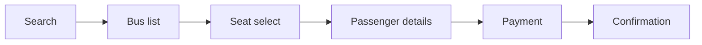

# Experiment 2 – Prototype of a Bus Ticket Booking System (Figma)

**Tool:** Figma  **CO:** CO1

## Aim
Sketch a simple, clickable prototype of a bus-ticket booking flow.

## Screens (see `wireframes.svg` for the low-fidelity reference)
1. **Search** – from, to, date, passengers, *Search Buses*
2. **Bus list** – operator, departure time, fare, filters
3. **Seat selection** – seat map, selected seat + fare
4. **Passenger details** – name, age, phone, email
5. **Confirmation** – PNR, seat, download ticket

## Figma procedure
1. Open Figma → **New design file** → name it *Bus Ticket Booking*.
2. Press **F** and create 5 *Frames* using the **Phone → iPhone 14** preset; rename them as above.
3. Build UI with **Rectangle (R)**, **Text (T)**, and **Auto layout (Shift+A)**. Make *Button* and *Bus card* **Components (Ctrl/Cmd+Alt+K)** and reuse them.
4. Switch to the **Prototype** tab. Drag the connector from *Search Buses* → Frame 2, *card* → Frame 3, *Continue* → Frame 4, *Proceed to Pay* → Frame 5 (**Interaction: On click → Navigate to**, animation *Smart animate*).
5. Press **▶ Present** to test the flow. Use **Share → Copy link** and paste the link below.

## Deliverable
* Figma prototype link: `PASTE_LINK_HERE`
* Screenshots in `screenshots/`: frames overview and prototype flow arrows.

## User flow

